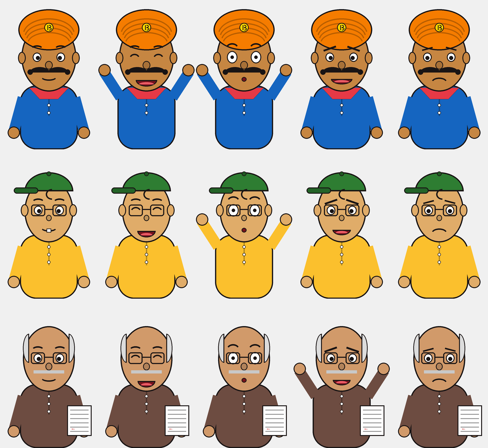

# 🎬 Desi Mining Wala — रोज़ की कॉमेडी रील बनाने वाला फ्री एजेंट

Instagram: **@desi.mining.wala**

यह एजेंट हर रोज़ अपने-आप:
1. एक नया **देसी कॉमेडी स्किट** लिखता है (मिनिंग वाले भैया 👳, भोला पप्पू 🧢, बिजली वाले अंकल 🧾)
2. हिंदी **आवाज़** बनाता है (Microsoft Edge की फ्री आवाज़)
3. **कार्टून वीडियो** (1080×1920 रील) बनाता है — होंठ आवाज़ के साथ हिलते हैं, हिंदी कैप्शन, घूमते पंखे वाली ASIC मशीनें
4. आखिर में एंड-कार्ड: **"बिटकॉइन माइनिंग मशीन चाहिए? DM करो @desi.mining.wala"** + crypto डिस्क्लेमर
5. वीडियो + कैप्शन आपके **Telegram** पर भेजता है, या सीधा **Instagram पर पोस्ट** करता है

💰 **खर्चा: ₹0** — GitHub Actions (फ्री), edge-tts (फ्री), Google Gemini (फ्री key, ऑप्शनल), Telegram (फ्री)।



सैंपल वीडियो: [`output/sample/reel.mp4`](output/sample/reel.mp4)

---

## ✅ शुरू करने के 3 स्टेप (10 मिनट)

### स्टेप 1 — GitHub Actions चालू करें
1. यह रिपो GitHub पर खोलें → **Actions** टैब → "I understand… enable" दबाएँ।
2. यह कोड रिपो की **main (default) ब्रांच** पर होना चाहिए — GitHub रोज़ का शेड्यूल सिर्फ़ default ब्रांच पर चलाता है।
3. **Actions → "रोज़ की कॉमेडी रील" → Run workflow** दबाकर पहली रील अभी बना लें।
   बन जाने पर उसी रन के नीचे **Artifacts** में `reel-<तारीख>` से वीडियो डाउनलोड करें।

इसके बाद हर रोज़ सुबह ~8:45 बजे (IST) नई रील अपने-आप बनेगी।

### स्टेप 2 — (बहुत अच्छा) रोज़ वीडियो Telegram पर पाएँ
1. Telegram में **@BotFather** → `/newbot` → नाम दें → जो **token** मिले उसे कॉपी करें।
2. अपने नए बॉट को एक मैसेज भेजें, फिर **@userinfobot** से अपना **chat id** लें।
3. GitHub रिपो → **Settings → Secrets and variables → Actions → New repository secret**:
   - `TELEGRAM_BOT_TOKEN` = बॉट का token
   - `TELEGRAM_CHAT_ID` = आपका chat id

अब रोज़ वीडियो + तैयार कैप्शन फ़ोन पर आएगा → Instagram पर शेयर करें (चाहें तो ऐप में ट्रेंडिंग म्यूज़िक जोड़ें)।

### स्टेप 3 — (ऑप्शनल) AI से रोज़ बिल्कुल नए जोक्स
बिना AI के भी एजेंट `config/skits.yaml` के 12 तैयार स्किट घुमाता रहता है।
हर दिन नया स्किट चाहिए तो:
1. https://aistudio.google.com/apikey पर Google अकाउंट से **फ्री API key** बनाएँ।
2. GitHub Secret जोड़ें: `GEMINI_API_KEY` = वह key

---

## 📲 सीधा Instagram पर ऑटो-पोस्ट (ऑप्शनल, फ्री लेकिन सेटअप लंबा)
Meta की ऑफिशियल Graph API से:
1. Instagram अकाउंट को **Professional (Creator/Business)** बनाएँ और एक **Facebook Page** से जोड़ें।
2. https://developers.facebook.com पर ऐप बनाएँ → "Instagram Graph API" जोड़ें → permissions
   `instagram_basic`, `instagram_content_publish`, `pages_show_list` के साथ **long-lived access token** बनाएँ।
3. GitHub Secrets: `IG_USER_ID` (Instagram Business Account ID) और `IG_ACCESS_TOKEN`।
4. Instagram को वीडियो का **public लिंक** चाहिए — workflow अपने-आप GitHub Release बनाकर लिंक देता है,
   इसलिए इसके लिए **रिपो public होना चाहिए**।

> ⚠️ Long-lived token ~60 दिन में एक्सपायर होता है, तब नया डालना होगा। तब तक Telegram वाला तरीका सबसे भरोसेमंद है।

---

## 🔍 अपनी पुरानी वीडियो एनालाइज़ करवाना
एजेंट आपकी असली रील्स देखकर आपका बोलने का स्टाइल, टॉपिक और हुक सीखता है:
1. Instagram ऐप → **Settings → Your activity → Download your information** → Media → अपनी वीडियो डाउनलोड करें।
2. सारी `.mp4` फ़ाइलें `my_videos/` फ़ोल्डर में डालें।
3. कंप्यूटर पर (Python 3.10+ और ffmpeg के साथ):
   ```bash
   pip install -r requirements.txt faster-whisper
   python -m agent.analyze
   ```
4. रिपोर्ट `analysis/report.md` में मिलेगी, और सीखा हुआ स्टाइल `config/learned_style.json` में — यह फ़ाइल
   GitHub पर commit कर दें, फिर रोज़ की स्क्रिप्ट इसी स्टाइल में लिखी जाएगी (Gemini key के साथ)।

---

## 🤖 Claude Code स्किल
`.claude/skills/desi-mining-reel/SKILL.md` — Claude Code में यह रिपो खोलकर बस बोलें
*"आज की रील बनाओ"* या *"दिवाली पर एक स्किट बनाओ"*, Claude खुद स्क्रिप्ट लिखकर वीडियो रेंडर कर देगा।

## 🛠️ अपने कंप्यूटर पर चलाना
```bash
pip install -r requirements.txt        # + ffmpeg ज़रूरी
python run_daily.py                    # output/<आज की तारीख>/reel.mp4
python run_daily.py --script my.json   # अपनी लिखी स्क्रिप्ट से
python agent/character.py              # कैरेक्टर शीट देखें
```

## ✏️ क्या-क्या बदल सकते हैं
| क्या | कहाँ |
|---|---|
| नाम, आवाज़, रंग, तकिया-कलाम, डिस्क्लेमर | `config/character.yaml` |
| तैयार जोक्स/स्किट | `config/skits.yaml` |
| कैरेक्टर का लुक | `agent/character.py` |
| दुकान का बैकग्राउंड, एंड-कार्ड | `agent/render.py` |
| रोज़ का टाइम | `.github/workflows/daily-reel.yml` (`cron`, UTC में) |

## ⚖️ ज़रूरी
- हर वीडियो और कैप्शन में crypto जोखिम का डिस्क्लेमर है (भारत में ASCI की crypto-विज्ञापन गाइडलाइन के हिसाब से)।
  स्क्रिप्ट में "पैसा डबल / गारंटीड प्रॉफिट" जैसी बातें ब्लॉक हैं — इन्हें न हटाएँ।
- AI से लिखी स्क्रिप्ट पोस्ट से पहले एक बार ज़रूर देख लें (Telegram वाला तरीका इसी लिए बेहतर है)।
- फ़ॉन्ट: Baloo 2 (SIL Open Font License, फ्री)।
